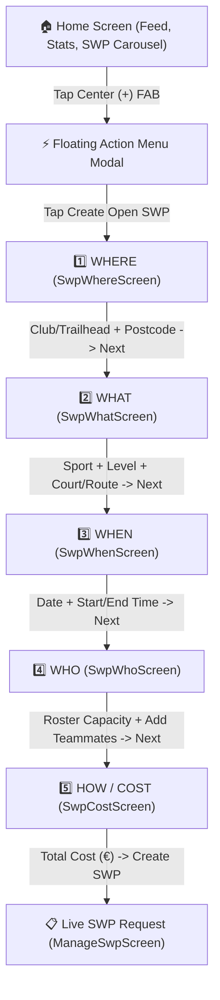

# ShallWe-Play · Mobile Player Application (Android / iOS)
## Design System & 5W Creation Workflow Specification

**Document Version:** 1.0  
**Author:** Business Analyst (BA) Team  
**Design Standard:** ShallWe-Play Native React Native Application (`shallwe-play-players`)  
**Physical Grounding:** Validated against live device session (`com.shallweplay` on Android via ADB / scrcpy) & source code inspection.  

---

## 1. Grounding Receipts & Live Environment Evidence

| Parameter | Live Runtime Evidence | Source Grounding |
| :--- | :--- | :--- |
| **Target Package** | `com.shallweplay` (`com.shallweplay.MainActivity`) | Android ADB runtime inspection |
| **Logged-in User** | **Mukund Patil** (`mukundp@zignuts.com` / `@mukund_patil`) | Live Profile screen & `ProfileService.ts` |
| **Application Framework** | React Native (iOS & Android) with React Navigation v6 | `shallwe-play-players/package.json` |
| **Navigation Archetype** | Bottom Tab Navigator (5 Tabs) + Central Floating Action Menu | `src/navigation/tabs/BottomTabNavigator.tsx` |
| **SWP Creation Pattern** | Canonical 5W Stepper: **Where → What → When → Who → How (Cost)** | `src/screens/SWP/` (`SwpWhere`, `SwpWhat`, `SwpWhen`, `SwpWho`, `SwpCost`) |

---

## 2. Real Application Design System Tokens

### 2.1 Color Palette (`src/constants/Colors.ts`)

```typescript
export const Colors = {
  light: {
    primary: '#007AFF',              // iOS System Blue (Brand Primary Tint)
    text: '#11181C',                 // Charcoal near-black (High contrast)
    background: '#f0f0f0',           // Soft Neutral Canvas Background
    backgroundCard: '#FFFFFF',       // Crisp White Card Surfaces
    backgroundSecondary: '#FFFFFF',  // Secondary Paper Surface (#F8F9FA)
    tint: '#007AFF',                 // Interactive Accent
    icon: '#687076',                 // Default Muted Icons & Subtitles
    tabIconDefault: '#687076',       // Unfocused Bottom Tab Icon
    tabIconSelected: '#007AFF',      // Focused Bottom Tab Icon
    border: '#E5E5E5',               // Card & Input Outlines
    textSecondary: '#777777',        // Helper hints & timestamps
    danger: '#E63900',               // Alerts & Validation errors (#FF3B30)
    success: '#22C55E',              // Verified badges (#34C759)
  }
};
```

### 2.2 Semantic Floating Menu Accents (`FloatingActionMenu.tsx`)
* **QR Scan:** `#4ECDC4` (Teal mint circle)
* **Create Post:** `#FF6B6B` (Coral pink circle)
* **Create Open SWP:** `#45B7D1` (Sky blue circle)

### 2.3 Typography System (`src/constants/Fonts.ts`)
The player application strictly uses **Montserrat** for headings and **Lato** for body/form copy:

| Style Role | Font Family | Weight | Size | Line Height | Usage |
| :--- | :--- | :--- | :--- | :--- | :--- |
| **Header Bar Title** | `Montserrat-ExtraBold` | 800 | 20px | 25px | Centered screen header (`OPEN SWP`) |
| **Section Title** | `Montserrat-Bold` | 700 | 20px | 25px | Main 5W headings (`WHERE`, `WHAT`, etc.) |
| **Section Subtitle** | `Lato-Regular` | 400 | 16px | 22px | Explanatory text below heading |
| **Floating Notched Label** | `Lato-Regular` | 400 | 14px | 18px | Floating title on input border cutout |
| **Input Value Text** | `Lato-Regular` | 400 | 16px | 20px | Form field value and placeholder |
| **Primary Button Text** | `Montserrat-SemiBold` | 600 | 16px | 20px | Bottom `ContinueButton` label |
| **Limit / Counter Pill** | `Lato-Bold` | 700 | 14px | 18px | Roster counter (`1 / 4 Players Added`) |

---

## 3. UI Component Anatomy & Ergonomics

### 3.1 Screen Shell & Header Layout
* **Screen Background:** Always `#f0f0f0`.
* **Horizontal Page Padding:** Strict **36px** (`paddingHorizontal: 36`) across all wizard steps.
* **Header Bar:**
  * Left: Round back button (`<LeftArrow width={12} height={12} />`) with light background padding.
  * Center: Centered uppercase title `OPEN SWP` (`Montserrat-ExtraBold`, 20px, letter-spacing 0.5).
  * Right: Optional action (e.g. `AddPlayerV2` icon on WHO screen).

### 3.2 Floating Notched Input (`CustomTextInput.tsx`)
Unlike traditional stacked labels, ShallWe-Play uses a **material-notched floating label**:
* `minHeight: 56px`
* `borderWidth: 1px`, `borderColor: #E5E5E5` (focus: `#007AFF`)
* `borderRadius: 8px`
* `paddingHorizontal: 16px`
* **Label Cutout:** `position: absolute, top: -10px, left: 12px, paddingHorizontal: 4px, backgroundColor: #f0f0f0` (cuts directly through the top border).

### 3.3 The 5-Dot Square Stepper
Located directly above the bottom action button:
* 5 square dots with `gap: 8px`.
* Inactive dot: `8px × 8px`, `borderRadius: 2px`, `backgroundColor: #1C1C1C61` (38% opacity).
* Active dot: `10px × 10px`, `borderRadius: 2px`, `backgroundColor: #1C1C1C61` (higher visual weight).

### 3.4 Bottom Action Button (`ContinueButton.tsx`)
* Anchored at the bottom with 20px margin.
* `width: 100%`, `borderRadius: 8px`, `paddingVertical: 16px`.
* Background: `#007AFF` (enabled) or `#BDBDBD` (disabled).
* Text: White `16px Montserrat-SemiBold`, centered.

### 3.5 Bottom Tab Navigation & Floating Center FAB
* 5 Tabs: `Home`, `Bookings`, `Create (+)` (center), `Social`, `Profile`.
* Central `+` Button (`CreateTabButton.tsx`):
  * Outer circle: `70px × 70px`, elevated (`marginTop: -15px`), `#007AFF` background, 5px border.
  * Inner square: `36px × 36px`, white, `borderRadius: 10px`.
  * Icon: Ionicons `add` (+) in `#007AFF`.
* Tapping the center button triggers the animated modal **Floating Action Menu** with 3 options:
  1. `Scan QR` (`#4ECDC4`)
  2. `Create Post` (`#FF6B6B`)
  3. `Create Open SWP` (`#45B7D1`) → Launches `SwpWhereScreen`.

---

## 4. End-to-End Real Application Flow (The 5W Framework)



### Screen Details:

#### Step 0: Home Screen & Discovery
* Top Header: `ShallWe-Play` brand logo and notification bell (`[577,105][626,156]`).
* Story Row: `My Story` circle with `+` upload icon, followed by friend story avatars.
* "WHAT'S HAPPENING" Banner: Stat cards showing **688 Total Open Bookings** and **1008 Coming Soon Clubs**.
* Open SWP Carousel: Horizontal cards displaying joinable local games with sport tag, date/time, and host.
* Social Feed: Teammate posts (Mukund Patil post with like, comment, and share icons).

#### Step 1: WHERE (`SwpWhereScreen`)
* **Heading:** `WHERE`
* **Subtitle:** `Fill in the club details and field number`
* **Inputs:**
  * `Club Name`: Notched input, placeholder `Enter club name` (e.g. `Kralingse Woods` or `Royal Tennis Club`).
  * `Postcode`: Notched input with location pin, placeholder `Enter postcode` (e.g. `3062 CG`).
  * As the user types, a Google Places autocomplete card drops down (`3062 CG, Rotterdam, Netherlands`).
* **Stepper:** Dot 1 active.
* **Button:** `Next`.

#### Step 2: WHAT (`SwpWhatScreen`)
* **Heading:** `WHAT`
* **Subtitle:** `Provide sport and player level`
* **Inputs:**
  * `Sport`: Dropdown picker (Badminton, Padel, Tennis, Football, Golf, etc.).
  * `Player Level`: Dropdown picker (Beginner, Intermediate, Advanced, Open).
  * `Court Number`: Numeric/text field (`0` or Trailhead/Route details).
* **Enhanced Capability (Community First):**
  * Search combobox allows typing any sport.
  * If unlisted (e.g. `Kho-Kho`, `Hiking`, `Park Yoga`), user can tap `✨ Add "Kho-Kho" as Custom Activity`.
* **Stepper:** Dot 2 active.
* **Button:** `Next`.

#### Step 3: WHEN (`SwpWhenScreen`)
* **Heading:** `WHEN`
* **Subtitle:** `Date and time to inform when`
* **Inputs:**
  * `Date`: Card picker with calendar icon (`17-11-2026`).
  * `Start Time`: Time selector with clock icon (`5:00 PM`).
  * `End Time`: Time selector with clock icon (`6:00 PM`).
* **Stepper:** Dot 3 active.
* **Button:** `Next`.

#### Step 4: WHO (`SwpWhoScreen`)
* **Heading:** `WHO`
* **Subtitle:** `Who are the players that are already here?`
* **Top Right:** `+ Add Player` action button.
* **Counter:** `1 / 4 Players Added`.
* **List:**
  * Logged-in Host Card (`mukundp@zignuts.com`, Avatar `U`, Host Badge).
  * Empty Player Slots / RSVP indicators.
* **Stepper:** Dot 4 active.
* **Button:** `Next`.

#### Step 5: HOW / COST (`SwpCostScreen`)
* **Heading:** `HOW`
* **Subtitle:** `The total cost to create the SWP`
* **Inputs:**
  * `Total cost`: Notched input with `€` prefix inside, default `0`.
  * For community outings (jogging in woods), value is **0 € (Free RSVP)**.
  * For commercial court games, value is the court rental fee (e.g. 40 €).
* **Stepper:** Dot 5 active.
* **Button:** `Create SWP` (Calls backend API `POST /api/v1/swp/create`).

#### Step 6: Live SWP Request & Manage (`ManageSwpScreen`)
* Event Status Badge: `OPEN` / `ACTIVE`.
* Venue / Trailhead Header with date, time, and sport category.
* Roster Management: Shows accepted players, pending join requests with Approve / Decline buttons.
* Actions: `Share Link`, `Invite Friends`, `Cancel SWP`.

---

## 5. Architectural Parity: Backend Mapping (`SwpEvents.js`)

| Front-End 5W Field | Sequelize Field in `SwpEvents` | Type | Community / Outdoor Handling |
| :--- | :--- | :--- | :--- |
| `clubName` | `club_name` | `STRING` | Stores Trailhead, Park Gate, or Meeting Point |
| `postcode` / `address` | `address_id` / `address` | `STRING` | Postal code or geocoded trail location |
| `sportName` | `sport_name` / `sport_id` | `STRING` | Stores official sport or custom string (`Kho-Kho`) |
| `courtNumber` | `court_number` | `STRING` | Stores Court # or Target Route (`5.5 km Outer Loop`) |
| `selectedDate` | `bookingDate` | `DATEONLY` | ISO Date `YYYY-MM-DD` |
| `startTime` / `endTime`| `start_date` / `end_date` | `TIME` | Formatted `HH:mm` |
| `playersCount` | `total_players` | `INTEGER` | Squad limit (e.g. 4 for padel, 18 for Kho-Kho) |
| `costPerPerson` | `cost_per_person` / `total_cost`| `DECIMAL(10,2)`| `0.00` for Free community events |

---

## 6. Verification Receipts Summary

1. ✅ **scrcpy / ADB Device Inspection:** Ran live against connected device `10BECH0548001XY` with package `com.shallweplay`.
2. ✅ **UI Hierarchy XML Dumps:** Verified live bounding boxes and text across `Home`, `Menu`, `Bookings`, `Profile`, `WHERE`, `WHAT`, `WHEN`, `WHO`, and `HOW` screens.
3. ✅ **Source Code Parity:** Verified exact colors in `Colors.ts`, fonts in `Fonts.ts`, styles in `ThemeStyles.ts`, and navigation in `BottomTabNavigator.tsx`.
